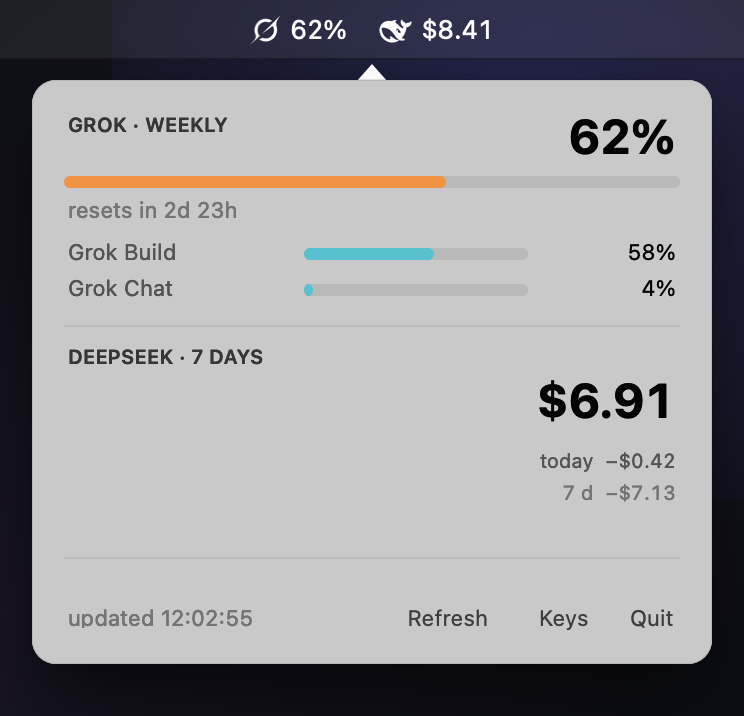

# AIQuota

A tiny native macOS menu bar app that shows your **Grok weekly credit** and **DeepSeek balance** at a glance.

```
[grok] 34%   [deepseek] $9.93
```

Click the icon for a compact panel: Grok weekly usage with a reset countdown and per-product split (Grok Build / Grok Chat), DeepSeek balance with today's spend, and an animated spend chart that toggles between the last 7 days and the current day's hours.



## Features

- **Menu bar at a glance** — brand marks plus two numbers, tinted to match the system menu bar.
- **Popover panel** — weekly Grok percentage, reset countdown, product breakdown, DeepSeek balance, "today" spend, and a bar chart of spend.
- **Chart with two modes** — click it to morph between 7 days and 24 hours with a short animation.
- **Lives in the Keychain** — no plain-text credentials, no config files with secrets.
- **Automatic OAuth refresh** — the xAI refresh token is used before the access token expires; the rotated pair is stored back in the Keychain.
- **Cheap** — one process, no daemons, 60 s polling (backs off to 180 s when idle), paused while the Mac sleeps.

## Requirements

- macOS 13 or newer
- Xcode Command Line Tools (`xcode-select --install`)
- A DeepSeek API key and/or a Grok (xAI) OAuth token

## Install

```bash
git clone https://github.com/oleqich/aiquota.git
cd aiquota
./scripts/install.sh
```

The script builds `AIQuota.app` into `~/Applications`, installs a LaunchAgent so it starts at login, and launches it.

Then click the menu bar icon → **Keys…** and paste your credentials. Leave a field empty to keep the current value.

## Credentials

| Source | Service in Keychain | What it is |
|---|---|---|
| DeepSeek | `aiquota-deepseek` | API key (`sk-…`), used against `https://api.deepseek.com/user/balance` |
| Grok | `aiquota-grok` | xAI OAuth access token |
| Grok | `aiquota-grok-refresh` | xAI OAuth refresh token (`offline_access`) |

Nothing is written to disk in plain text. The app shells out to `/usr/bin/security` to read and write the Keychain, so items belong to your login keychain and can be inspected or removed with Keychain Access.

If you use [OpenClaw](https://openclaw.ai) and it already holds an xAI login, AIQuota will import that token from `~/.openclaw/state/openclaw.sqlite` when the Keychain is empty, and writes rotated tokens back so both keep working. Disable with `AIQUOTA_SYNC_OPENCLAW=0`, or point it at another store with `AIQUOTA_STATE_DB`.

## How it works

Two GET requests per cycle, nothing else leaves your Mac:

- `GET https://api.deepseek.com/user/balance` with `Authorization: Bearer <key>` → `balance_infos[].total_balance`.
- `GET https://cli-chat-proxy.grok.com/v1/billing?format=credits` with `Authorization: Bearer <xAI token>` → `config.creditUsagePercent` for the weekly window.

The Grok endpoint is the one the Grok CLI uses; it is **not** a documented public API and may change at any time. The app reports the HTTP status in the panel if it does.

Spend-per-day and spend-per-hour are computed locally from balance samples (a decrease between two samples is spend). History is kept for 8 days in `~/Library/Application Support/AIQuota/history.json`: one sample per minute for the last day, thinned to one per five minutes older than that.

## Building manually

```bash
./scripts/build.sh          # → dist/AIQuota.app
./scripts/build.sh --run    # build and launch
```

The app is a single Swift file (`Sources/AIQuota.swift`) compiled with `swiftc`. No packages, no Xcode project.

## Uninstall

```bash
./scripts/uninstall.sh
```

Removes the app, the LaunchAgent, local history and logs. Keychain items stay; delete them in Keychain Access if you want a clean slate.

## Notes

- The menu bar item is an `NSStatusItem` with `NSPopover`; no Dock icon, no windows.
- The timer is invalidated on `willSleep` and restored on `didWake`.
- One instance only: launching a second copy exits immediately.
- Logs: `~/Library/Logs/AIQuota.log` (rotates at 1 MB, written only on change).

## License

MIT — see [LICENSE](LICENSE).
